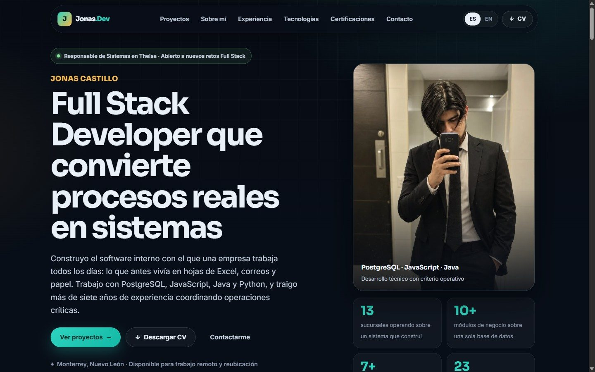

<div align="center">

# Jonas Castillo · Portafolio

**Full Stack Developer** que convierte procesos reales en sistemas

[](https://portafolio-topaz-five.vercel.app/)
[](https://www.linkedin.com/in/jonascastillo/)



</div>

## Sobre el proyecto

Sitio personal hecho a mano, sin frameworks ni proceso de build: HTML, CSS y JavaScript puro, publicado en Vercel. Presenta cada proyecto explicando el problema, mi responsabilidad y el resultado, no solo la lista de tecnologías.

## Qué cuenta (actualización de octubre de 2026)

1. **Proyecto destacado: sistema interno de operaciones para una empresa de mudanzas** (Thelsa Mobility Solutions, 13 sucursales). Se describe en términos generales. Las capturas se tomaron en una copia de prueba del sistema y solo muestran pantallas sin datos de clientes ni cifras del negocio: menú de módulos, agenda del mes, capacidad operativa, mapa del Plan de Viajes, seguridad y guía del ejecutivo.
2. **Groundsight Geoservicios**: el sitio de la empresa de estudios geofísicos de Brenda Pamela ([código](https://github.com/johannesquintanar-dev/groundsight)). Las capturas son reales.
3. **Calculadora de Servicios Aeroportuarios**, **Syntax Logistics** y **Mundo Fifas**.
4. Sobre mí, experiencia (incluye el puesto actual), stack, certificaciones y contacto.

## Características

- **Diseño minimalista** con tres temas (oscuro por omisión, claro y colorido); la preferencia se recuerda.
- **Caso técnico del cotizador comercial** (motor de precios en PL/pgSQL homologado al centavo, volumetría, flete por matriz de distancias, listas con herencia, viáticos automáticos).
- **Caso técnico del puente con CONTPAQi** (servicio de Windows en .NET que factura por SDK) y detalle técnico de Groundsight (Rockie, asistente, comparador, generador estático).
- **Escaparate del proyecto destacado** con pestañas: cada una enseña una pantalla real del sistema y explica qué resuelve.
- **Bilingüe (ES / EN)** con detección automática del idioma del navegador; también traduce las pestañas y leyendas del escaparate.
- **Diseño mobile-first**, probado en escritorio (1440 px) y teléfono (390 px).
- **Accesible:** menú móvil con control de foco y cierre con Escape, pestañas navegables con el teclado, modal del CV adaptable y textos alternativos en todas las imágenes.
- **SEO completo:** Open Graph, Twitter Card, datos estructurados JSON-LD, `sitemap.xml` y `robots.txt`.
- **Rápido:** imágenes en WebP con dimensiones declaradas, carga diferida y caché inmutable de recursos.
- **CV descargable** en español e inglés.

## Tecnologías


## Estructura

```
index.html               Página única con todas las secciones (los textos con data-i18n salen de js/i18n.js)
css/portafolio.css       Sistema visual oscuro, mobile-first
js/i18n.js               Textos en español e inglés
js/script.js             Menú, idioma, modal del CV y animaciones de aparición
js/portafolio.js         Escaparate con pestañas del proyecto destacado y contadores
assets/images/thelsa/    Capturas del sistema de Thelsa (copia de prueba, sin datos de clientes)
assets/images/proyectos/ Capturas de Groundsight, Syntax Logistics y Mundo Fifas
assets/images/           Retrato e imagen para redes (og-jonas-castillo.png)
assets/cv/               CV en español e inglés (PDF)
assets/cv/fuente/        Fuente del CV (HTML + CSS) y el script que regenera los PDF
assets/favicon/          Ícono del sitio
vercel.json              URLs limpias y encabezados de seguridad y caché
```

## Correr en local

```bash
npx serve .
```

También funciona con Live Server de VS Code.

## Para actualizar

- Textos: en `js/i18n.js` (español e inglés). Lo que no lleva `data-i18n` se edita en `index.html`.
- Capturas del sistema: solo pantallas sin datos de clientes y con la banda de prueba recortada; cada una lleva su pestaña en el escaparate y su leyenda en `js/i18n.js` (`thelsa.tab.*`, `thelsa.cap.*`).
- Currículum: editar `assets/cv/fuente/cv-es.html` y `cv-en.html` y correr `node assets/cv/fuente/generar-cv.mjs` (usa el Chrome o Edge instalado; los PDF se regeneran con el mismo formato).
- Después de cambiar CSS o JS, subir la fecha de `?v=AAAAMMDD` en `index.html` para que el navegador no use la copia vieja.
- Regla de siempre: nada del sistema de Thelsa que sea real (datos de clientes, cifras internas o reglas de negocio) entra a este repositorio.

## Contacto

- Correo: [johannesq.dev@gmail.com](mailto:johannesq.dev@gmail.com)
- LinkedIn: [jonascastillo](https://www.linkedin.com/in/jonascastillo/)
